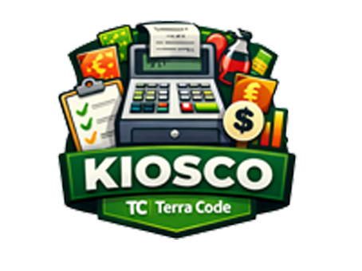
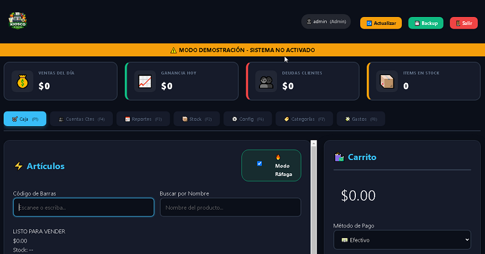
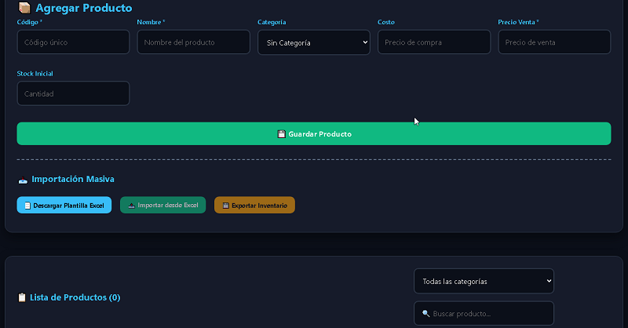
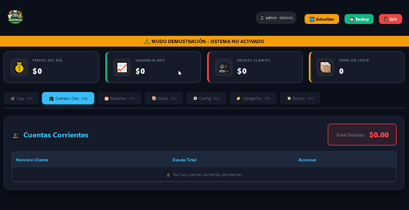
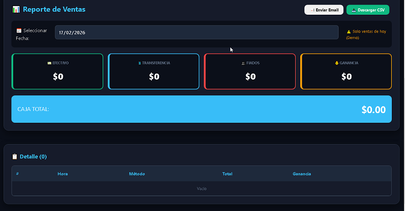
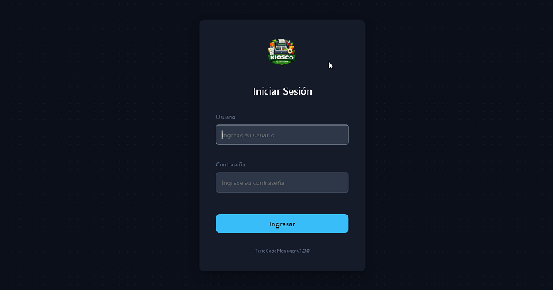
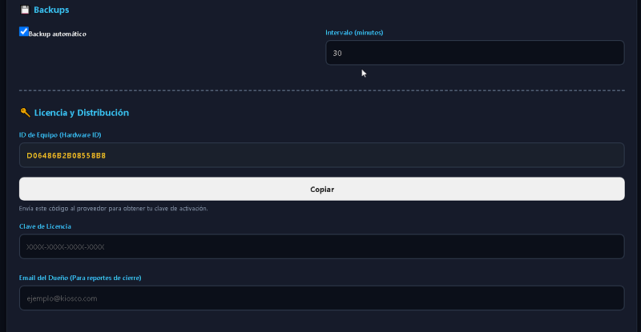

# 🖥️ TerraCodeManager Web

<p align="center">
  
</p>

<p align="center">
  <strong>Landing page y plataforma web oficial de presentación para TerraCodeManager</strong><br>
  <em>Sistema Integral de Gestión de Ventas, Inventario, Cuentas Corrientes y Reportes Comerciales</em>
</p>

<p align="center">
  <a href="https://terracode.com.ar"></a>
  <a href="https://www.linkedin.com/in/luciano-ruizdiaz/"></a>
  <a href="mailto:lurdciano@gmail.com"></a>
  <a href="LICENSE"></a>
</p>

---

## 📖 Descripción del Proyecto

**TerraCodeManagerWeb** es la interfaz web promocional e interactiva diseñada para dar a conocer **TerraCodeManager**: un sistema de escritorio integral para la gestión comercial y administrativa de pequeños y medianos comercios (kioscos, almacenes, tiendas, minimercados y distribuidoras).

La plataforma web combina una estética moderna *dark mode* con acabados en *glassmorphism*, ofreciendo a los clientes y usuarios una demostración completa e intuitiva de las capacidades del software, vista interactiva de capturas de pantalla reales, reproductor de video demostrativo y especificaciones de licenciamiento.

---

## 📸 Capturas de Pantalla Reales del Sistema

A continuación se presentan capturas reales de los distintos módulos que integran el ecosistema **TerraCodeManager**:

### 🛒 Pantalla Principal y Punto de Venta (POS)
> Interfaz rápida optimizada para ventas de mostrador, cálculo de vueltos, emisión de comprobantes y manejo simultáneo de medios de pago.

<p align="center">
  
</p>

---

### 📦 Control de Inventario y Stock
> Gestión de catálogo de artículos, códigos de barra, alertas visuales por stock crítico, control de reposición y filtros instantáneos.

<p align="center">
  
</p>

---

### 💳 Cuentas Corrientes y Fiados
> Registro detallado de deudas de clientes, entrega de mercadería fiada, imputación de abonos parciales y consulta histórica de saldos.

<p align="center">
  
</p>

---

### 📈 Reportes, Estadísticas y Balances
> Informes de ventas por rangos de fecha, ganancias netas estimadas, resumen por método de cobro y exportación de datos.

<p align="center">
  
</p>

---

### 🔐 Seguridad y Control de Acceso
> Identificación segura de operadores y supervisores, diferenciación de permisos por rol de usuario para resguardar la información.

<p align="center">
  
</p>

---

### 🔑 Activación y Administración de Licencias
> Control de estado de activación, validación offline mediante clave criptográfica de producto y soporte para modo de evaluación de 30 días.

<p align="center">
  
</p>

---

## ✨ Características Principales de TerraCodeManager

- **⚡ Punto de Venta de Alta Velocidad (POS):** Cobros en efectivo, transferencias bancarias / billeteras virtuales, fiados y tarjetas. Arqueos de caja por turno y control de discrepancias.
- **🏷️ Gestión de Inventario:** Control de existencias, cálculo de márgenes y precios de venta, soporte para lector de código de barras y avisos de stock mínimo.
- **📒 Cuentas Corrientes (Libreta Digital):** Registro fidedigno de clientes, cobranzas, pagos a cuenta y límites crediticios.
- **📊 Reportes Financieros y de Caja:** Balance de ingresos, costos, utilidades estimadas y exportación de reportes a formatos estándar (CSV/PDF).
- **👥 Roles y Multi-Usuario:** Perfiles asignables (Administrador con privilegios totales vs. Cajero con acceso acotado a la operación del turno).
- **💾 Base de Datos Local y Confiable:** Funciona de forma 100% offline gracias a su base de datos SQLite integrada, garantizando continuidad de negocio aun sin conexión a internet.
- **🛡️ Copias de Seguridad:** Soporte para respaldos automáticos y manuales para resguardar las operaciones comerciales.

---

## 🌐 Tecnologías de la Web

La landing page `TerraCodeManagerWeb` fue desarrollada con un enfoque de alto rendimiento, cero dependencias pesadas y máxima compatibilidad:

- **HTML5 Semántico:** Estructura accesible (`aria-*`, `roles`, microformatos).
- **CSS3 Moderno:** Variables CSS nativas, degradados oscuros, efectos de desenfoque *backdrop-filter* (Glassmorphism), layout responsivo con Flexbox y CSS Grid.
- **JavaScript Vanilla (ES6+):** Lightbox para visualización de capturas a pantalla completa, modal de video demo interactivo (`Demo.mp4`), copiado inteligente al portapapeles y navegación fluida (*smooth scroll*).
- **Seguridad Web (.htaccess):** Políticas estrictas de *Content Security Policy* (CSP), *X-Frame-Options: DENY*, *X-Content-Type-Options: nosniff*, restricción de navegación de directorios y protección de archivos sensibles.

---

## 📂 Estructura del Repositorio

```text
TerraCodeManagerWeb/
├── .gitattributes          # Configuración de normalización de saltos de línea Git
├── .htaccess               # Cabeceras de seguridad HTTP y protección de archivos
├── LICENSE                 # Licencia de código abierto MIT
├── README.md               # Documentación general con capturas de pantalla
├── index.html              # Landing page principal e interactiva
└── images/                 # Recursos multimedia y capturas reales
    ├── CtaCte.png          # Captura: Módulo Cuentas Corrientes
    ├── Demo.mp4            # Video demostrativo del sistema en acción
    ├── icon.ico            # Ícono de aplicación y favicon
    ├── Licencia.png        # Captura: Módulo de Licencia
    ├── Login.png           # Captura: Login y seguridad
    ├── logo.png            # Logotipo oficial de TerraCode
    ├── Principal.png       # Captura: Módulo de Caja y Punto de Venta
    ├── Reportes.png        # Captura: Módulo de Reportes
    └── Stock.png           # Captura: Módulo de Stock
```

---

## 🚀 Despliegue y Visualización Local

Para visualizar el sitio web de forma local:

1. **Clonar el repositorio:**
   ```bash
   git clone https://github.com/Lurdciano/TerraCodeManagerWeb.git
   cd TerraCodeManagerWeb
   ```

2. **Abrir en el navegador:**
   - Simplemente haz doble clic sobre `index.html`, o
   - Inicia un servidor web estático liviano:
     ```bash
     # Usando Python:
     python -m http.server 8000

     # O usando Node.js (npx):
     npx serve .
     ```
   - Abre en tu navegador favorito: `http://localhost:8000`

---

## 💻 Requisitos del Sistema (Software TerraCodeManager)

Para la ejecución de la aplicación de escritorio **TerraCodeManager**:

| Componente | Requisito Mínimo |
| :--- | :--- |
| **Sistema Operativo** | Windows 7 / 8 / 10 / 11 (64-bit) |
| **Memoria RAM** | 4 GB mínimo (8 GB recomendado) |
| **Almacenamiento** | 500 MB libres para el sistema y base de datos SQLite |
| **Pantalla** | Resolución de 1280 × 720 px o superior |
| **Conexión** | No requerida para operación cotidiana (100% Offline) |

---

## 👨‍💻 Autor y Contacto

Desarrollado y mantenido por **Luciano Ruiz Diaz** (*TerraCode*):

- 🌐 **Sitio Web Oficial:** [terracode.com.ar](https://terracode.com.ar)
- 💼 **LinkedIn:** [luciano-ruizdiaz](https://www.linkedin.com/in/luciano-ruizdiaz/)
- ✉️ **Correo Electrónico:** [lurdciano@gmail.com](mailto:lurdciano@gmail.com)
- 📍 **Ubicación:** Reconquista, Santa Fe, Argentina

---

## 📄 Licencia

Este proyecto se distribuye bajo los términos de la Licencia **MIT**. Consulta el archivo [LICENSE](LICENSE) para más detalles.
